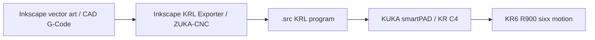
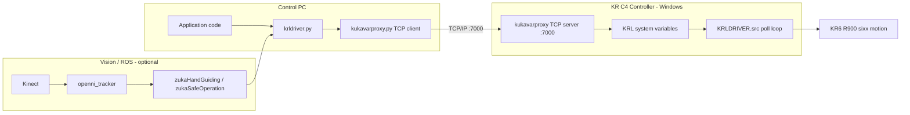

# ZuKa — Industrial & Research Applications for the KUKA KR6 R900 sixx

> Commissioning, offline/online programming, and vision-based control of a KUKA KR6 R900 *sixx* industrial manipulator.

ZuKa is the software and documentation suite produced for a project (Mechatronics Program, Zagazig University). It covers the full lifecycle of putting a KUKA KR C4–controlled robot into service and then extending it well beyond its factory capabilities: from base setting, mastering and end-effector installation, through **offline programming** (G-Code / vector-art → KUKA Robot Language), to **online, real-time control** from any PC over TCP/IP — including two computer-vision research applications built on ROS and the Microsoft Kinect.

---

## Table of Contents

- [Overview](#overview)
- [System Architecture](#system-architecture)
- [Repository Layout](#repository-layout)
- [Hardware & Software Requirements](#hardware--software-requirements)
- [Components](#components)
  - [1. kukavarproxy Message Format](#1-kukavarproxy-message-format)
  - [2. KRL Driver (Python Robot API)](#2-krl-driver-python-robot-api)
  - [3. Inkscape → KRL Exporter](#3-inkscape--krl-exporter)
  - [4. ZUKA-CNC](#4-zuka-cnc)
  - [5. openni_tracker (ROS)](#5-openni_tracker-ros)
  - [6. zukaHandGuiding (ROS)](#6-zukahandguiding-ros)
  - [7. zukaSafeOperation (ROS)](#7-zukasafeoperation-ros)
- [End-to-End Setup Guide](#end-to-end-setup-guide)
- [KRL Driver API Reference](#krl-driver-api-reference)
- [Safety Notice](#safety-notice)
- [Documentation](#documentation)
- [Credits & Resources](#credits--resources)
- [License](#license)

---

## Overview

The project addresses four recurring challenges when deploying an industrial robot for machining and research: **accuracy, ease of use, flexibility, and safety**. It delivers three deliverables:

| Phase | Goal | Deliverables |
|-------|------|--------------|
| **Commissioning** | Bring the robot into service | Base setting, mastering, calibration, end-effector (pneumatic gripper & electric spindle) installation |
| **Industrial application** | Use the robot as a CNC machine | Post-processing tools that convert conventional G-Code / vector art into KUKA Robot Language (KRL) for 2D drawing and 3D milling |
| **Research applications** | Visual servoing | Kinect + ROS **hand-guiding** (control the robot with hand gestures) and a **human-safe operating zone** (robot slows/stops when a person approaches) |

The keystone enabling the online applications is a **Python API** (the *KRL Driver*) that lets any networked PC command the robot in real time by reading and writing KRL system variables over TCP/IP.

---

## System Architecture

Two complementary control strategies are used.

**Offline (file-based) programming** — geometry is authored in a CAD/vector tool, converted to a `.src` KRL program, transferred to the smartPAD, and executed on the robot:



**Online (real-time) programming** — a PC talks to `kukavarproxy` running on the KR C4, which reads/writes KRL system variables while a resident KRL program (`KRLDRIVER.src`) polls those variables and executes the requested motions:



The vision layer (Kinect → `openni_tracker` → ROS nodes) feeds skeleton tracking data into the same Python API, closing the loop for gesture control and proximity-based safety.

---

## Repository Layout

```
zuka/
├── codes/
│   ├── inkscape-kuka/            # Inkscape extension: vector paths → KRL
│   ├── krl-driver/              # Python API + resident KRL program (online control)
│   ├── kukavarproxy-msg-format/ # Protocol spec + C++/Python reference implementations
│   ├── openni_tracker/          # ROS package: Kinect skeleton tracking + closest-user distance
│   ├── ZUKA-CNC/                # Standalone G-Code → KRL CNC application (Windows)
│   ├── zukaHandGuiding/         # ROS package: gesture-based robot guiding
│   └── zukaSafeOperation/       # ROS package: proximity-based safe operating zone
├── documents/
│   ├── finalReport/             # LaTeX source of the graduation thesis
│   └── userManual/              # LaTeX source of the user manual
├── docs/                        # Jekyll project website
└── templates/                   # LaTeX report/manual templates
```

---

## Hardware & Software Requirements

**Hardware**
- KUKA **KR6 R900 sixx** manipulator with **KR C4** controller and smartPAD
- End-effectors used in the project: pneumatic gripper and electric spindle
- Microsoft **Kinect** (for the vision applications)
- A control PC on the same network as the KR C4

**Software**
- `kukavarproxy` (rev. 6.1.x) running on the KR C4 (Windows)
- Python 2.x on the control PC (the driver uses Python 2 socket/encoding semantics; see notes in [krl-driver](#2-krl-driver-python-robot-api))
- **ROS** (with `rospy`, `std_msgs`, `tf`) for the vision applications
- **OpenNI / NITE** `1.5.2.21` or `1.5.2.23` for `openni_tracker`
- **Inkscape** for the KRL exporter extension

---

## Components

### 1. kukavarproxy Message Format

`codes/kukavarproxy-msg-format/` — the wire protocol used by every online component.

`kukavarproxy` is a TCP/IP server that runs on the KR C4 and listens on **port 7000**. It reads and writes KRL/KRC system variables on request, providing the bridge between an external PC and the robot's runtime. The binary message format is:

| Field | Size | Description |
|-------|------|-------------|
| Message ID | 2 bytes (HEX) | Correlates request/response |
| Message length | 2 bytes (HEX) | Length of the payload that follows |
| Mode | 1 byte | `0` = read, `1` = write |
| Variable name length | 2 bytes (HEX) | |
| Variable name | *n* bytes | ASCII |
| Variable value length | 2 bytes (HEX) | (write only) |
| Variable value | *n* bytes | ASCII (write only) |

The folder contains the protocol diagram plus reference implementations in **C++** and **Python**. See [`codes/kukavarproxy-msg-format/README.md`](codes/kukavarproxy-msg-format/README.md) for details.

### 2. KRL Driver (Python Robot API)

`codes/krl-driver/` — the heart of the online control system. It has two cooperating halves:

- **`KRLDRIVER.src`** — a KRL program that runs *resident* on the robot. After initialization it enters a `WHILE TRUE` loop that reads the `KRLD_COM` command variable and dispatches the requested action via a `SWITCH` statement (PTP, LIN, CIRC, relative moves, `WAIT`, `$BASE`/`$TOOL` setting, velocity/approximation, digital outputs, palletizing mode). The PC sets motion parameters into dedicated `KRLD_*` variables and then writes the command code into `KRLD_COM`; the robot resets `KRLD_COM` to `0` when it accepts the command.
- **`kukavarproxy.py`** — a thin `KUKA` class implementing the message format above (`connect`, `read`, `write`, `disconnect`).
- **`krldriver.py`** — a high-level, KRL-like Python API layered on top (`PTP`, `LIN`, `CIRC`, `BASE`, `TOOL`, `VEL_CP`, `OUT`, `GRIPPER_OPEN`, …). See the [API reference](#krl-driver-api-reference).

**Command dispatch table (`KRLD_COM`)**

| Code | Action | Code | Action |
|------|--------|------|--------|
| 1 | `PTP` (axis) | 9 | Set `$BASE` (+ offset) |
| 2 | `PTP` (position) | 10 | Set `$TOOL` |
| 3 | `LIN` | 11 | Set approximation (`$APO`) |
| 4 | `CIRC` | 12 | Set `$VEL.CP` |
| 5 | `PTP_REL` (axis) | 13 | Set PTP velocity (`BAS #VEL_PTP`) |
| 6 | `PTP_REL` (position) | 14 | Set digital output `$OUT[]` |
| 7 | `LIN_REL` | 15 | Set `$PAL_MODE` |
| 8 | `WAIT SEC` | | |

**Concurrency guard.** On start the driver writes a random `PRO_ID` to the robot. Every API call verifies `PRO_ID` still matches; if another program has claimed the robot the call raises an error. This prevents two PCs from silently fighting over the same manipulator.

> **Python version note.** `kukavarproxy.py` currently uses Python 2 byte/`encode('hex')` semantics in the read path (a Python 3 variant is present but commented out). Run the driver with Python 2, or port the marked sections before using Python 3.

See [`example.py`](codes/krl-driver/example.py) and [`example2.py`](codes/krl-driver/example2.py) for runnable demonstrations (pick-and-place, chessboard palletizing, motion primitives).

### 3. Inkscape → KRL Exporter

`codes/inkscape-kuka/` — an Inkscape extension that converts the contours of text and images into a KRL `.src` program for KR C4 controllers. It is derived from the *Repetier G-Code Plugin for Inkscape*.

**Install:** copy `kukakrl.inx` and `kukakrl.py` into Inkscape's `share/extensions` directory and restart Inkscape. The tool then appears under `Extensions → KUKA Tools → Path to KRL`.

**Workflow:** author text/paths → convert objects to paths (`Shift+Ctrl+C`) → run the extension → set tool, base, speeds, Z-depth, and approximation → **Apply** to emit the `.src` file and preview the motion path.

The extension exposes the full KRL motion parameter set — tool (`$TOOL` / `TOOL_DATA[n]`), base (`$WORLD` / `BASE_DATA[n]`), Euler orientation (A/B/C), work & travel feedrates, work Z-depth, travel Z-height, and approximation type (`C_DIS` / `C_VEL` / `C_ORI`) with its value. Full option-by-option documentation, including approximation theory, is in [`codes/inkscape-kuka/README.md`](codes/inkscape-kuka/README.md).

### 4. ZUKA-CNC

`codes/ZUKA-CNC/` — a standalone Windows application (`ZUKA_CNC.exe`, Tcl/Tk based) that turns conventional **G-Code** into KRL, enabling the robot to be driven like a CNC machine for 2D drawing and 3D milling. This is the industrial-application post-processor referenced in the thesis.

### 5. openni_tracker (ROS)

`codes/openni_tracker/` — a ROS package (C++) that uses the Kinect via OpenNI/NITE to detect and track users, **broadcasting each user's skeleton joints as `tf` frames** (head, neck, torso, hands, elbows, shoulders, hips, knees, feet). It additionally publishes the distance to the closest user on the **`/closestUser`** topic (`std_msgs/Float32`), which the safe-operation node consumes.

> **NITE dependency.** OpenNI/NITE must be installed manually. Compatible versions: `1.5.2.21` and `1.5.2.23`. See [`codes/openni_tracker/README.md`](codes/openni_tracker/README.md).

### 6. zukaHandGuiding (ROS)

`codes/zukaHandGuiding/` — a ROS node (`rospy`) that subscribes to the skeleton `tf` frames from `openni_tracker` and maps the operator's hand and torso motion to robot motion, letting a person **guide the robot by hand gestures**. It:

- averages 50 tf readings per cycle to smooth noise;
- uses the **left hand** position (relative to the torso) to drive the robot's Cartesian position and the torso yaw to drive base rotation;
- uses distinct **right-hand gestures** ("kicks") to start/stop tracking and to toggle the gripper open/closed.

It builds directly on the [KRL Driver](#2-krl-driver-python-robot-api) API (bundled into `src/`).

### 7. zukaSafeOperation (ROS)

`codes/zukaSafeOperation/` — a ROS node implementing a **vision-based safe operating zone**. It subscribes to `/closestUser` and, when a person comes within a configurable `safeRange`, drops the robot's program override (`$OV_PRO`) to a limited speed; when the area clears, full speed is restored. A watchdog thread keeps `openni_tracker` alive. This directly implements the "safety" pillar of the project by reducing robot speed whenever a human enters its workspace.

---

## End-to-End Setup Guide

### A. Prepare the controller (`kukavarproxy`)

1. Obtain `kukavarproxy` (rev. 6.1.x) and copy it to a USB drive.
2. On the KR C4, log in as **Expert/Administrator** (`KUKA Menu → Configuration → User Group`; default password `kuka`).
3. Minimize the HMI (`KUKA Menu → Startup → Service → Minimize HMI`) and run `KUKAVARPROXY.exe`. If `cswsk32.ocx` errors, register it: `regsvr32.exe C:\path\to\cswsk32.ocx`.
4. (Optional) Add a shortcut to the Windows Startup folder for auto-start.

### B. Network configuration

1. Put the KR C4 and control PC on the same (preferably private) network.
2. Configure the KR C4 IP (`KUKA Menu → Startup → Network Configuration`).
3. Unlock **port 7000**: `Advanced → NAT → Add Port → 7000`, protocols `tcp/udp`.

### C. Load the resident KRL program

Transfer [`KRLDRIVER.src`](codes/krl-driver/KRLDRIVER.src) to the smartPAD, select it, and run it. It initializes base/tool/velocity and then waits for commands.

### D. Drive it from Python

```python
from krldriver import *

INI()                       # sensible defaults for velocity/base/tool + home
PTP(POS, 0, 0, 100, 0, 0, 0)  # Cartesian PTP move
LIN(50, 0, 100)               # linear move
GRIPPER_CLOSE()               # actuate gripper
```

> Update the controller IP in [`krldriver.py`](codes/krl-driver/krldriver.py) (`KUKA('172.31.1.147')`) to match your robot before running.

### E. Vision applications (optional)

1. Install OpenNI/NITE (`1.5.2.21` or `1.5.2.23`) and build the ROS workspace with `catkin_make`.
2. `rosrun openni_tracker openni_tracker`
3. Run `zukaSafeOperation` and/or `zukaHandGuiding` (update the controller IP inside those scripts).

---

## KRL Driver API Reference

All functions live in [`krldriver.py`](codes/krl-driver/krldriver.py). Empty string arguments (`""`) leave the corresponding axis/coordinate unchanged for relative moves.

**Setup**

| Function | Description |
|----------|-------------|
| `INI(VEL_CP=3, VEL_AXIS=100, OV_PRO=10, APO=0)` | Initialize velocities, base, tool, and home; recommended first call. |
| `BASE(x,y,z,a,b,c, offX…offC, BASE_DATA=-1)` | Set `$BASE` from explicit frame or `BASE_DATA[n]`, with optional offset. |
| `TOOL(x,y,z,a,b,c, TOOL_DATA=-1)` | Set `$TOOL` from explicit frame or `TOOL_DATA[n]`. |
| `APO(value)` | Approximation distance for `C_PTP` / `C_DIS`. |
| `VEL_CP(v)` | CP (LIN/CIRC) velocity in m/s. |
| `VEL_PTP(pct)` | PTP velocity as % of max. |
| `OV_PRO(pct)` | Program override (overall speed) 0–100 %. |

**Motion**

| Function | Description |
|----------|-------------|
| `PTP(AXIS or POS, v1…v6)` | Point-to-point move (axis-specific or Cartesian). |
| `PTP_REL(AXIS or POS, v1…v6)` | Relative PTP move. |
| `LIN(x,y,z,a,b,c)` | Linear move. |
| `LIN_REL(x,y,z,a,b,c)` | Relative linear move. |
| `CIRC(dest…, aux…)` | Circular move through auxiliary point. |
| `PTP_HOME()` | Move to the home posture. |

**I/O & utility**

| Function | Description |
|----------|-------------|
| `OUT(port, TRUE/FALSE)` | Set a digital output. |
| `GRIPPER_OPEN()` / `GRIPPER_CLOSE()` | Gripper actuation (ports 1 & 4). |
| `PAL_MODE(TRUE/FALSE)` | Toggle `$PAL_MODE`. |
| `WAIT(seconds)` | Dwell. |

`AXIS` and `POS` are module constants selecting axis-specific vs. Cartesian interpolation.

---

## Safety Notice

This software commands a full-size industrial robot capable of causing serious injury or property damage. Before running any online component:

- Keep the physical **E-STOP** within reach and test it first.
- Start with low `OV_PRO` (the examples default to ~10 %) and verify motions in a clear cell.
- Confirm base/tool frames and axis limits match your actual setup before executing paths.
- The proximity safety node (`zukaSafeOperation`) is an **assistive** feature, not a certified safety device — it does not replace guarding, safety-rated monitored stop, or risk assessment.

---

## Documentation

- **Graduation thesis** — full technical report (LaTeX): [`documents/finalReport/`](documents/finalReport/)
- **User manual** (LaTeX): [`documents/userManual/`](documents/userManual/)
- **Project website** — Jekyll site: [`docs/`](docs/)
- Component READMEs: [inkscape-kuka](codes/inkscape-kuka/README.md), [kukavarproxy-msg-format](codes/kukavarproxy-msg-format/README.md), [openni_tracker](codes/openni_tracker/README.md)

---

## Credits & Resources

Bachelor graduation project, Mechatronics Program, Zagazig University (2017). The robot was made available through the Tempus project *"JIM2L"*.

Key upstream references:

- openshowvar / kukavarproxy — <http://sourceforge.net/projects/openshowvar/>
- JOpenShowVar — <https://github.com/aauc-mechlab/jopenshowvar/>
- Repetier G-Code Plugin for Inkscape — <https://www.repetier.com/repetier-g-code-plugin-for-inskscape/>
- KUKA XYZABC / Euler angles — <http://javakuka.com/xyzabc/>
- ROS `openni_tracker` — <http://ros.org/wiki/openni_tracker>
- KUKA KST Expert Programming Manual, KSS 5.2

---

## License

License terms are provided per component (see the `LICENSE` files under `codes/inkscape-kuka/` and `docs/`). Refer to those files and the accompanying thesis for usage and attribution requirements.
